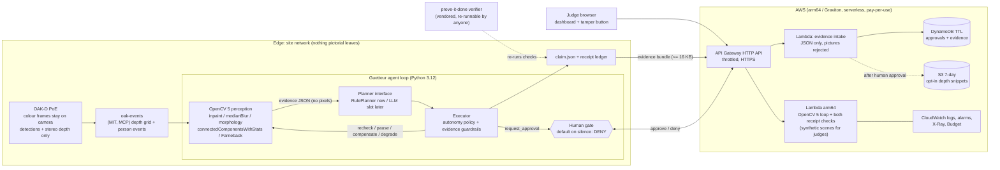
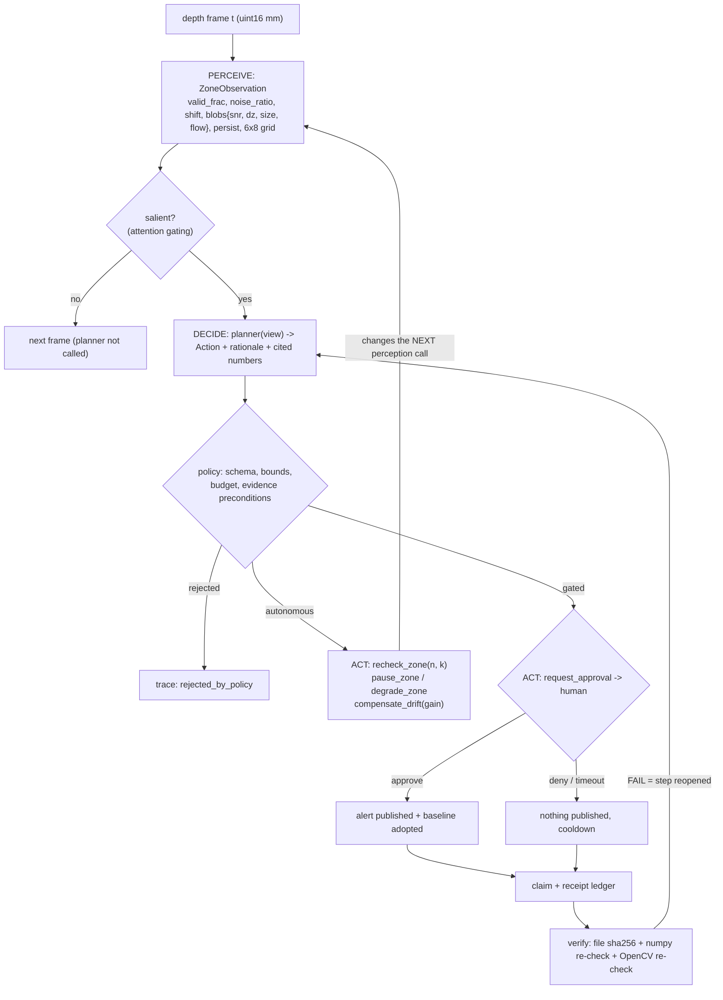

# Guetteur (Team Drift) — design document

*OpenCV AI Competition 2026, powered by AWS. Target: Overall entry that also qualifies for the **Agentic Vision Award**.*
Draft of 2026-10-12. Local prototype exists and passes its tests; **nothing is deployed, registered, submitted or published**.
Rule citations use the short names defined in `docs/RULES_NOTES.md` (DP-Overview, DP-Rules, OCV).

## 0. Read this first: three things that can sink the entry

1. **Eligibility is unverified.** OCV says "Registration closes Aug 17, 2026" ("Competition at a Glance"), that the build phase is for "all teams that submitted the required proposal" ("Build Phase Details"), and lists "Submit the cloud compute grant proposal" under "Requirements for Participation". DP-Overview still shows a Join button and says teams without a grant "remain eligible to continue". We have not established that Team Drift is registered and has a proposal on file. Alex must check before more effort is spent. (Section 12, ask #1.)
2. **Deadline is stated two ways.** Devpost's header and countdown: Oct 26, 2026 @ **11:45pm PDT**; DP-Overview body text and OCV: **11:59 p.m. PT**. We plan to 11:45pm and aim to submit on **Oct 25**.
3. **Nothing here has touched real hardware or AWS.** All results are synthetic; every artifact says so. Real OAK-D recordings and a deployed endpoint are the two things the schedule in section 11 exists to deliver.

## 1. One-paragraph pitch

Guetteur is a privacy-first active-perception agent. It watches a space through **depth only** (a Luxonis OAK-D PoE; colour frames never leave the camera), uses **OpenCV 5** to turn depth frames into small, pixel-free evidence (changed regions, people-shaped occupants, sensor health, drift), and lets an agent decide what to do *next* from that evidence: look again with more frames when the signal is ambiguous, pause a zone while someone is standing in it, compensate for sensor drift instead of reporting a phantom change, or stop and ask a human before anything outward-facing happens (default on silence: deny). Every claim it makes ("the shelf item is gone", "the camera lost depth") is a small JSON object with a **receipt**: two independent re-checks against the pinned input, in the [prove-it-done](https://github.com/issaquahd/prove-it-done) format, so a sceptical judge can re-run them and watch a doctored claim fail. A serverless AWS stack (Lambda on Graviton behind API Gateway) runs the same OpenCV 5 loop and receipt checks behind a judge-facing HTTPS endpoint.

## 2. Problem, users, impact

**Problem.** Camera-based AI usually means shipping pictures to someone else's cloud and trusting the system's summary. Two things go wrong: people's images leave the room, and agents report things nobody can check ("zone clear", "item removed") — including when the sensor itself is broken, drifting, or looking at a person it mistakes for a change.

**Users.** (a) Small operators who want to know "did something change on that shelf / in that equipment room / at that door?" without a video archive: stockrooms, labs, makerspaces, server or network closets, community fridges and tool libraries. (b) Homes and care settings where occupancy and "something changed" matter but pictures are unacceptable (always opt-in, with consent; see section 10). (c) Builders of agent systems who need a reference for *verifiable* vision claims.

**Impact we can honestly claim.** We make no statistical claims about harm reduced. What the project demonstrates and measures: (1) a vision agent that works from depth only, so there is no image to leak; (2) fewer false alarms and fewer silent failures than a threshold-and-alert pipeline on the same evidence (measured, synthetic, section 9); (3) every published claim is independently re-checkable. Real-world benefit is a hypothesis until real recordings are evaluated (section 9.4).

## 3. System at a glance

### 3.1 Architecture (OpenCV 5 + agent + AWS)

### 3.2 Agent workflow (perception → decision → action), as the Agentic Vision evidence requires (OCV "Final Submission Package")

The loop is closed in two places that matter for the award: `recheck_zone` changes *how OpenCV is called next* (frames integrated, threshold `k`), and the approval request is sized by what OpenCV measured. A fixed-script pipeline cannot do either (ablation in section 9).

### 3.3 Data flow, concretely

| Step | Data | Where | Leaves the edge? |
| --- | --- | --- | --- |
| capture | colour + stereo | camera chip | colour: never; depth only to host |
| perceive | depth `uint16[240,320]` per frame | host RAM | no; frame discarded after analysis |
| evidence | JSON: scalars, up to 3 blobs, 6x8 signed-mm grid | host | only on escalation, <= 16 KB, pictures rejected by schema |
| claim | JSON: region, frame windows, asserted value, input digest | host disk | optional, same bundle |
| receipt | re-check of the claim against the **pinned input** | wherever the input is | see 3.4 |

### 3.4 Privacy model, and exactly what a receipt re-runs against

* **Privacy comes from depth-only sensing.** Colour never reaches the host (inherited from `oak-events`: the colour sensor feeds the on-chip detector only). There is no host-side "redaction" step because there is nothing to redact: no code path reads, writes or sends a picture, and a test (`tests/test_synth_and_privacy.py`) scans code, data and run outputs for image/video files and for imaging calls. Depth still reveals occupancy, silhouettes at close range and timing, so event files are treated as sensitive and kept local.
* **Receipts need an input to re-run against. Two modes, stated plainly:**
  1. *Recorded or synthetic clips* (demo, evaluation, judge endpoint): the claim pins the clip by content digest (SHA-256 over the depth bytes); `file:` and digest checks fix it. Anyone can re-run the checks.
  2. *Live operation*: the raw depth stream is **not retained**. The receipt then re-runs only against the reduced evidence (grid and blob statistics) or against a **short depth snippet kept only after a human approved an escalation** (7-day S3 lifecycle, opt-in). A live claim whose snippet was not kept is labelled "evidence reduced; not re-derivable from raw" in the ledger, never presented as fully re-checkable.
* **What the judge endpoint serves is synthetic**, labelled in the page and in every API response (`synthetic: true`). The endpoint refuses arbitrary uploads and visitor-chosen paths.

## 4. OpenCV 5 usage (substantive, and central)

Pinned: `opencv-python-headless==5.0.0.93` (reports `cv2.__version__ == "5.0.0"`). Headless because a manylinux **aarch64** wheel exists, so the same pin runs on Apple Silicon and on Lambda arm64.

| Stage | OpenCV 5 call | Purpose |
| --- | --- | --- |
| holes | `cv2.inpaint(TELEA)` on 16-bit depth | fill invalid stereo pixels without inventing data when coverage is gone |
| denoise | `cv2.medianBlur(5)` on 16-bit | speckle; its effect on noise is *measured at calibration* (`filt_gain`), not assumed |
| change | signed difference to a temporal-median baseline, in units of a fitted range-dependent noise model | per-pixel significance |
| clean-up | `cv2.morphologyEx` OPEN then CLOSE, elliptical kernel | remove specks, merge fragments |
| blobs | `cv2.connectedComponentsWithStats` | regions; physical size via the pinhole model |
| motion | `cv2.calcOpticalFlowFarneback` on 8-bit depth renderings | moving vs static; sway of a person |
| evidence | `cv2.resize(INTER_AREA)` to 6x8 | the only spatial evidence that may leave the device |
| receipt #2 | `cv2.mean(mask)`, `cv2.meanStdDev`, `cv2.countNonZero` | independent per-frame region statistics |

Per-stage timings on this Mac are in `eval/runtime.json` (`guetteur bench`). OpenCV 5-specific note: results are reproducible with the pinned wheel; we have not benchmarked against OpenCV 4 and make no performance comparison claim.

## 5. Agent design (Agentic Vision rubric: orchestration and autonomy)

* **Tools the planner can call** (`planner.py`): `continue`, `recheck_zone(n, k)`, `pause_zone(frames)`, `degrade_zone(frames)`, `compensate_drift(gain)` — autonomous; `request_approval(kind)` — gated.
* **Planner interface**: `plan(PlanView) -> Action`. `RulePlanner` is deterministic and is what evaluation runs. `LLMPlanner` takes any `complete(prompt) -> str` (Bedrock Converse is the intended one), gets the same JSON view (no pixels), must answer in the same schema, and **anything outside policy is rejected and replaced by the rule planner's choice, recorded in the trace**. An LLM can therefore be added without widening what the system is allowed to do.
* **Autonomy tiers (enforced by the executor, not by the planner):** observe, re-look, re-tune and compensate are autonomous and bounded (recheck n in [3,40], at most 3 rechecks per episode, drift compensation capped at ±20% total); anything that tells a human something happened needs `request_approval`.
* **Evidence guardrails:** an object claim is refused unless the *current* observation shows a confident, persistent, non-occupant blob in a healthy zone; a sensor claim is refused if coverage and gain look healthy. A planner (or LLM) cannot assert what the pixels do not show.
* **Attention gating:** the planner is only called when the observation is salient (quiet scenes: ~1% of zone-frames), which is also what makes an LLM planner affordable.
* **Human control:** `HumanGate.decide()` returns approve, deny, or `None` on no answer; `None` is deny. After a decision there is a cooldown so a persistent condition is not nagged every frame. Approval adopts the new scene as baseline. In the cloud, approvals live in DynamoDB with a TTL and expire to `denied_timeout`.
* **Observability:** every planner call writes a trace record (frame, zone, observation summary, action, rationale, cited numbers, outcome, planner ms) to `trace.jsonl`; counters for planner calls, rechecks, pauses, rejections, timeouts; the Lambda writes structured logs and metrics (CloudWatch) and an X-Ray trace.
* **Failure handling:** noise burst → degrade zone and wait; partial depth loss → degrade, then escalate if it persists; total loss → confirm for 3 frames then escalate; drift → compensate, escalate beyond 20%; recheck budget exhausted → drop, do not claim.

## 6. Receipts (prove-it-done, vendored)

Each claim is a done step in a ledger with three receipts through different instruments: `file:` (SHA-256 of the claim JSON), `cmd:` numpy-only re-check (never imports cv2; tested), `cmd:` OpenCV frame-statistics re-check. `--min-instruments 2` is required. Independence is partial and we say so: the two checks share the raw input and the claimed region/window, but not each other's estimator or the live pipeline's thresholds. Negative tests (`tests/test_receipts.py`): inflating the claimed value, pointing it at the wrong pixels (or time), re-pointing it at another recording, and editing the claim file each make the verifier exit 1 — including when the attacker recomputes the `file:` hash.

## 7. AWS services, free-tier fit, and cost note

All serverless, pay-per-use or free-tier eligible; no idle resources (no NAT gateway, VPC, EC2, load balancer, provisioned capacity or Marketplace subscription).

| Service | Role | Cost note |
| --- | --- | --- |
| Lambda (arm64/Graviton, python3.12, 1024 MB) | judge dashboard, `/api/run` (OpenCV 5 loop), `/api/verify` (both receipt checks), evidence intake | within Lambda's always-free monthly allowance at demo volumes; reserved concurrency 5 caps it |
| API Gateway HTTP API | HTTPS front door, throttled | priced per request; within free-tier allowance for new accounts at demo volumes |
| DynamoDB on-demand + TTL | approvals, evidence bundles | far below free allowance; TTL clears it |
| S3 (private, SSE, 7-day lifecycle) | opt-in depth snippets after human approval | negligible |
| CloudWatch Logs/Alarms, X-Ray, SNS, Budgets | observability and cost guard | within free allowances at this volume; a budget alert at 50%/80% of a cap the owner sets |

* Credits: DP-Overview "FREE AWS CREDITS FOR NEW MEMBERS" describes $100 in Free Tier credits at Free Plan sign-up (plus more via activities), subject to current Free Tier terms and expiry; we have not verified current terms, and no account exists yet. The design is meant to stay within those credits with margin; the throttles, reserved concurrency and budget alert are the guard rails.
* **Graviton:** the Lambda runs on arm64 and the wheel is aarch64, so the same code and pin are used on this Mac and in AWS. We do *not* claim the Best Use of COOL award: COOL (Cloud-Optimized OpenCV Library) is acquired through an AWS Marketplace listing, whose terms and pricing we have not reviewed, and the award requires measured COOL-vs-baseline evidence on Graviton (OCV "Focus Paths"). Optional stretch on Day 12 *only if* the listing is free and takes under an hour; otherwise skip.
* Template draft: `INFRA/template.yaml` (passes `cfn-lint`; not deployed; `sam validate` and `sam build` not run).

## 8. Judge demo (≤ 5 minutes) and the no-camera fallback

Requirements for the video: team, application working, architecture, principal results (OCV "Final Submission Package"). A working web endpoint is preferred over a screen-share (OCV "Requirements for Participation").

**Primary script (all on the AWS endpoint, ~4:30):**

| Time | Shown | Says |
| --- | --- | --- |
| 0:00–0:25 | title card, team, one-line pitch | who we are; depth only; receipts |
| 0:25–0:55 | architecture + agent-workflow diagrams | OpenCV 5, planner, human gate, AWS |
| 0:55–1:50 | dashboard: scenario `subtle_item_removed`, planner = rule | one frame is ambiguous (3.5σ) → `recheck_zone(n=7)` → OpenCV re-run → approval request; point at the cited numbers |
| 1:50–2:20 | same scene, planner = naive | misses it: the evidence changed what the agent did |
| 2:20–3:00 | `person_takes_item`, gate = approve; then `shelf_item_removed`, gate = timeout | zone pauses while occupied; alert only after they leave; silence = nothing published |
| 3:00–3:30 | `slow_drift`, `noise_burst`, `lens_obstructed` | sensor trouble ≠ scene event; compensate / wait / escalate |
| 3:30–4:10 | receipts: click "Tamper: double the claim" | both checks FAIL; show `guetteur verify-ledger` PASS on the honest ledger |
| 4:10–4:40 | results table + failure case (`subthreshold_item_removed`) | what it cannot do |
| 4:40–5:00 | what is real vs synthetic; thanks | honest labelling |

**Live-camera segment (optional, +30 s, only if Alex records it):** the OAK-D PoE clip replayed through the same loop, labelled "recorded real depth". If not recorded, the video says plainly that all scenes are synthetic.

**Fallback without the camera or the network:** `uv run guetteur demo` (narrated, deterministic, ~15 s), and `uv run guetteur serve` for the same dashboard at 127.0.0.1. The primary script *is* the no-camera path; the camera is an extra, never a dependency. Every screen shows "SYNTHETIC".

## 9. Evaluation plan

### 9.1 Metrics (all computed against machine-readable ground truth)
Event-level precision/recall of approval requests; scenario success (no false alert, no miss, required behaviours present); latency from event to request (frames and seconds at 5 fps); planner calls per frame; receipt verification rate (honest ledgers proven); tamper rejection rate; per-frame runtime (median/p95/p99) and per-stage OpenCV timings; policy rejections and approval outcomes.

### 9.2 Scenarios (11, ×3 seeds) and baselines
Control; obvious item removed; item added; subtle item removed (ambiguous); person walkthrough; person takes item; noise burst; slow gain drift; lens obstructed; partial washout; **sub-noise item removed (expected miss)**. Baselines: *naive* (threshold-and-alert, no executor guardrails), *naive + guardrails*, and the rule agent. Results: `docs/EVALUATION.md` (generated by `guetteur eval`). Snapshot (synthetic, 3 seeds, this Mac): the agent succeeded on 30/30 scenarios that are detectable and missed the 3 documented sub-noise runs (precision 1.00, recall 1.00 excluding that case); the raw threshold baseline succeeded on 12/33 with precision 0.25; 21/21 honest ledgers proven; 24/24 tampered ledgers rejected; median 8.6 ms per frame for both zones (p95 11.6 ms) against a 200 ms budget.

### 9.3 Failure cases we report, not hide
Sub-noise changes are invisible; depth cannot name objects; a person partly outside a zone can be momentarily read as a small change (the persistence rule absorbs it); thresholds were tuned on the same synthetic family they are scored on (an optimistic bias — the reason real recordings matter); noise is Gaussian in the generator but not on a real stereo pipeline.

### 9.4 What real data would add (needs Alex, section 12)
15–20 min recordings of depth only from the OAK-D PoE in three conditions (empty shelf/door, a person walking through, an item removed), labelled by Alex. Run through the identical loop; report the same metrics next to the synthetic ones. Without these the report says "synthetic only".

### 9.5 Mapping to the Agentic Vision rubric (DP-Rules "AGENTIC VISION AWARD RUBRIC")
| Criterion (weight) | Evidence we will point to |
| --- | --- |
| Substantive OpenCV 5 + agent integration (30) | section 4 table; traces where OpenCV output sets the next call's arguments |
| Orchestration and appropriate autonomy (25) | autonomy tiers, bounded rechecks, LLM slot behind policy, human gate |
| Task effectiveness and evaluation (20) | `docs/EVALUATION.md`, ablation vs naive, failure cases |
| Failure handling, observability, security, human control (15) | sensor-fault paths, trace + CloudWatch, default-deny gate, JSON-only intake, throttles, tamper tests |
| UX, documentation, demonstration (10) | dashboard, README, ≤5-min video |

## 10. Responsible use

* Depth-only by construction; no faces, no images, no video stored or sent (DP-Rules "RESPONSIBLE AND ETHICAL USE": surveillance risk needs "appropriate safeguards").
* Intended for spaces whose owner controls the camera and where people present know it is there; for homes and care settings only with the informed consent of everyone monitored. Not for workplace productivity monitoring, tracking individuals, or covert use. Stated in the README and the report.
* No identification: the system cannot, and is not designed to, say who someone is.
* Human control: alerts require a person's approval; silence means no alert; claims are labelled with their evidence basis; failures and limits are published.
* Truthful labelling (DP-Rules: entries may be rejected for misrepresenting "capabilities, results, benchmarks, or the role of human review"): synthetic data is marked synthetic everywhere; the LLM planner is described as an interface until a model is actually wired.
* Disclosure: the entry was built with AI coding assistance, and the agent in the product is deterministic code with an optional LLM slot; this is stated in the report (using an assistant to write the entry does not itself qualify as Agentic Vision: OCV "Focus Paths").
* Security of the public endpoint: scenario names and small JSON only, no uploads, no visitor-chosen paths, body size limit, API throttling, reserved concurrency, no secrets in the repo.

## 11. 14-day schedule (today is Oct 12; Day 1 = Oct 13; deadline Oct 26 11:45pm PDT, submit Oct 25)

| Day | Date | Milestone | Done when |
| --- | --- | --- | --- |
| 0 | Mon Oct 12 | prototype, tests, design, template draft (this work) | pytest green, eval + bench logs saved |
| 1 | Tue Oct 13 | **Alex: confirm eligibility/registration; decide go/no-go**; create repo `cloudlabworks/guetteur` after identity scan | answer recorded; repo exists |
| 2 | Wed Oct 14 | AWS account (Free Plan), budget alert, `sam validate`; `sam build --use-container` | template validates, build ok |
| 3 | Thu Oct 15 | first deploy; `/healthz` shows `opencv 5.0.0`, `aarch64`; dashboard loads from the public URL | curl receipt passes |
| 4 | Fri Oct 16 | record real depth clips (Alex + OAK-D, ~1 h); clip import tool (`oak-events` depth → `.npz`) | 3 labelled clips on disk (outside git if large) |
| 5 | Sat Oct 17 | run real clips through the loop; tune only on a held-out split; add real-data metrics | numbers in `docs/EVALUATION.md` |
| 6 | Sun Oct 18 | LLM planner wired to Bedrock behind the same policy (only if account/model access is straightforward; otherwise leave as interface and say so) | rejection tests pass with the real model |
| 7 | Mon Oct 19 | evidence intake hardening: `x-edge-key`, S3 snippet re-check function | negative tests pass |
| 8 | Tue Oct 20 | edge → cloud path end to end with a real clip; approvals from the dashboard | approval round trip in logs |
| 9 | Wed Oct 21 | technical report draft (from this document + results) | draft in `docs/REPORT.md` |
| 10 | Thu Oct 22 | architecture + workflow diagrams final; load/abuse test of the endpoint; cost check against credits | throttle and alarm demonstrated |
| 11 | Fri Oct 23 | video recording (script in section 8); screenshots | raw video |
| 12 | Sat Oct 24 | video edit; README polish; fresh-clone test of every command; (optional COOL probe) | clean clone passes |
| 13 | Sun Oct 25 | **submit** (Alex presses the button); endpoint check from outside the network | submission confirmation saved |
| 14 | Mon Oct 26 | buffer only; no new features; deadline 11:45pm PDT | — |

Cut order if time slips: COOL probe → LLM wiring → edge→cloud path → live-camera segment. Never cut: deployed endpoint, receipts + tamper demo, failure cases, honest labelling.

## 12. What needs Alex

1. **Eligibility check (blocking).** Is Team Drift registered on Devpost and did it submit the grant proposal? (Section 0, `docs/RULES_NOTES.md` #1.) If no, decide whether to ask `competition@opencv.org` (the contact on OCV "Contact & Questions") — we will not contact anyone on our own.
2. **AWS account**: create a Free Plan account under Cloud Lab Works (never a personal or employer account); set the budget figure; enable MFA; confirm the owner's alert email. We have no AWS credentials and did not look for any.
3. **Budget approval**: confirm that staying within Free Tier/promo credits is the rule, and that Bedrock model calls (Day 6) are in or out.
4. **Camera time**: ~1 hour with the OAK-D PoE on Day 4 (depth-only recordings of an empty shelf/door, a walk-through, an item removed) and a few minutes of labelling. No faces or identifiable people in any clip; anyone in frame must consent.
5. **Press submit** on Oct 25; the team representative handles the Devpost form (DP-Rules "ELIGIBILITY AND FAIR PLAY").
6. **Repo publication**: create `cloudlabworks/guetteur`, run the identity scan (noreply email, no employer material) before the first push.

## 13. Risks (ranked)

1. Not eligible / no proposal on file (section 0).
2. Synthetic-only evidence reads as weak "technical execution"; mitigated only by real clips (Day 4–5).
3. First AWS deployment problems (arm64 layer build needs Docker; Lambda 25 s ceiling vs ~2 s runs; cold start); Day 2–3 buffer.
4. Overfit to our own generator: thresholds tuned on the family they are scored on.
5. "Agentic" read as rules-with-extra-steps: the LLM slot is not wired until Day 6; the award text allows "any framework or model" (OCV "Focus Paths"), and the loop still satisfies "image or video results must influence a subsequent plan, tool call, action, or request for human approval".
6. Cost or abuse on a public endpoint: throttle, reserved concurrency, budget alert, no uploads.
7. Devpost/organiser rule drift: the pages defer to an "Official Rules" document we did not find; re-read all pages on Day 12.
