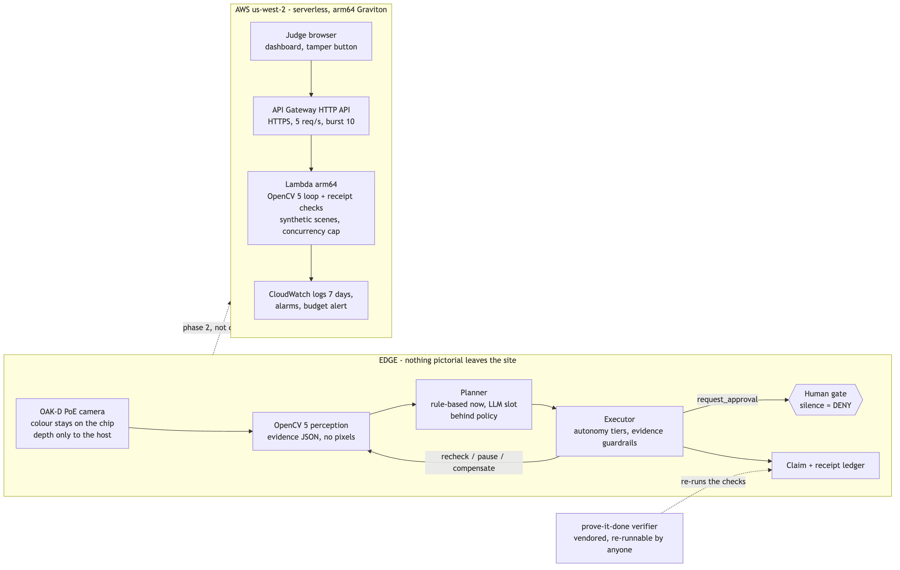
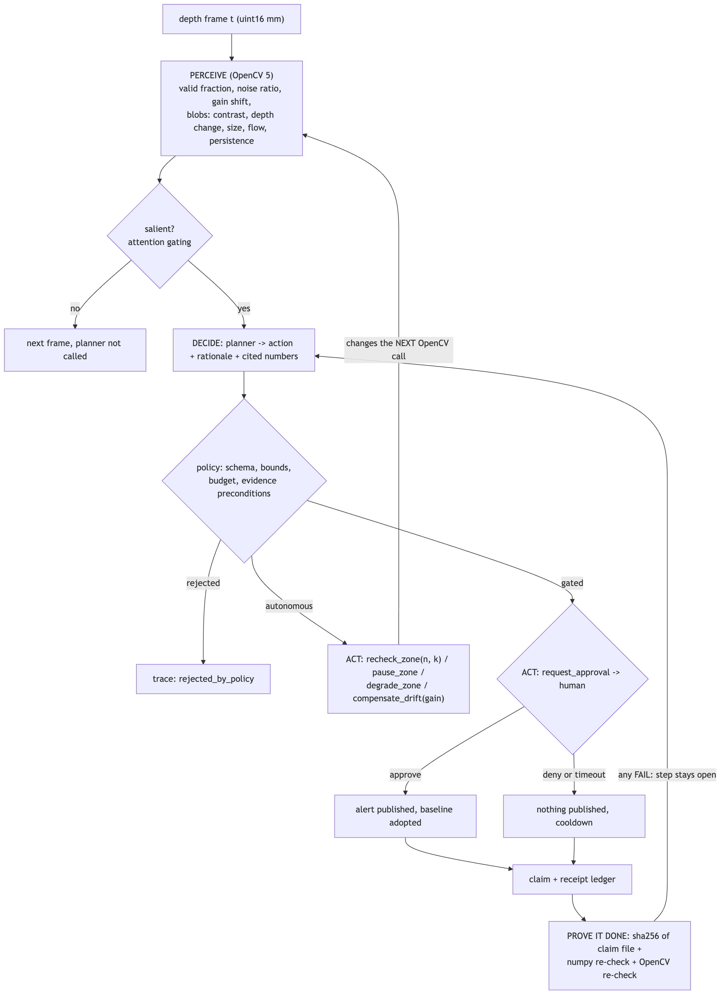

# Guetteur: active perception with receipts

**Team Drift. OpenCV AI Competition 2026, powered by AWS. Agentic Vision path. Technical report, draft of 2026-10-12.**

> **Status of the evidence.** Every number in this report was measured on **synthetic** OAK-D-style depth scenes with
> machine-readable ground truth, on a laptop-class CPU. No physical camera has been used yet and nothing has been
> deployed to AWS yet. Places where live-camera results or the AWS endpoint will go are marked **TODO**. Nothing marked TODO
> is claimed.

## 1. Summary

Guetteur ("lookout" in French) is a privacy-first agent that watches a space through **depth only**. It uses
**OpenCV 5** to turn depth frames into small, picture-free evidence, lets an agent choose what to do *next* from that
evidence, stops at a **human gate** before anything outward-facing happens (silence means deny), and attaches a
**re-runnable receipt** to every claim it makes, in the [prove-it-done](https://github.com/issaquahd/prove-it-done) format.

What the evaluation shows (synthetic, 11 scenarios x 3 seeds = 33 runs per planner):

| | Guetteur agent | Threshold-and-alert baseline |
| --- | --- | --- |
| Scenarios succeeded | **30/33** (every detectable case; the 3 misses are one documented sub-noise scenario) | 12/33 |
| Event precision | **1.00** (0 false alerts) | 0.25 (27 false alerts) |
| Event recall | **0.86** (1.00 excluding the documented miss) | 0.43 |
| Honest receipt ledgers proven | **21/21** | n/a |
| Doctored claims rejected | **24/24** | n/a |

The first contribution is the closed loop: an ambiguous observation changes *how OpenCV is called next* (frames
integrated, threshold), and the same evidence sizes the request to a human. The second is that no claim is accepted on the
agent's word: two independent estimators re-measure it against a pinned input and a doctored claim fails.

## 2. Problem

Camera-based AI usually means shipping pictures to someone else's cloud and trusting the system's summary. Two things go wrong.
People's images leave the room, and agents report things nobody can check ("zone clear", "item removed"), including when the
sensor itself is broken, drifting, or looking at a person it mistakes for a change.

Intended users: small operators who want to know "did something change on that shelf, in that equipment room, at that door?"
without keeping a video archive (stockrooms, labs, makerspaces, network closets, community tool libraries); homes and care
settings where occupancy and change matter but pictures are unacceptable (opt-in, with consent); and builders of agent systems who
need a reference for *verifiable* vision claims.

We make no statistical claim about harm reduced. What we demonstrate and measure: a vision agent that works from depth only (there
is no image to leak), fewer false alarms and silent failures than a threshold-and-alert pipeline on the same evidence, and claims
that anyone can re-check.

## 3. Architecture



*Figure 1. Architecture. Solid paths exist in code and are exercised by the tests. The dotted "phase 2" path (JSON-only evidence intake, approvals, DynamoDB with TTL, private S3 with a 7-day lifecycle) is written but has never run on AWS and is not in the first deploy.*

| Part | Status |
| --- | --- |
| Perception, planner, executor, human gate, claims, receipts (Python 3.12, OpenCV 5.0.0) | built; 75/75 tests pass |
| Judge dashboard + API (`/`, `/healthz`, `/api/scenarios`, `/api/run`, `/api/verify`) as one Lambda handler, also served locally | built; tested locally and on a linux/arm64 Lambda base image |
| AWS: API Gateway HTTP API + Lambda arm64 + CloudWatch + budget alert, one SAM stack | template validated (`sam validate --lint`, `cfn-lint`), built for arm64; **TODO(step 3): deployed** |
| Authenticated evidence intake, approvals, DynamoDB with TTL, private S3 for opt-in depth snippets | phase 2: code and local tests only, deliberately **not** in the first deploy |
| Real OAK-D depth input and clip recorder | **TODO(step 4)**: new opt-in code; the prototype reads synthetic or pre-recorded `.npz` clips |

**Privacy by construction.** The camera's colour sensor feeds only the on-chip detector; only stereo depth reaches the host. No code path reads,
writes or sends a picture, and a test scans code, data and run outputs for image/video files and imaging calls. Depth still reveals occupancy,
silhouettes at close range and timing, so event data is treated as sensitive. Evidence that would leave the device is JSON (scalars, up to three
blobs, a 6x8 signed-millimetre grid, at most 16 KB) and a schema rejects anything pictorial.

**What the public endpoint serves.** Built-in synthetic scenes only, labelled `synthetic: true` in the page and in every response. It accepts
scenario names and small JSON; no uploads, no visitor-chosen paths, body size limited.

## 4. The agentic loop and prove-it-done receipts



*Figure 2. Perception, decision, action, and proof. The loop closes in two places: an autonomous action changes the next OpenCV call, and a failed proof reopens the step.*

### 4.1 Tools, autonomy, and who may do what

The planner is an interface, `plan(view) -> Action`, and sees the same JSON evidence a human would, never pixels. Tools:

| Tool | Tier | Effect |
| --- | --- | --- |
| `continue` | autonomous | keep watching |
| `recheck_zone(n, k)` | autonomous | integrate `n` frames (3 to 40) and re-run OpenCV with threshold `k`; at most 3 per episode |
| `pause_zone(frames)` | autonomous | a person-sized, nearer-than-scene blob is present: do not judge scene changes meanwhile |
| `degrade_zone(frames)` | autonomous | noise burst or partial depth loss: wait, then escalate if it persists |
| `compensate_drift(gain)` | autonomous | correct sensor gain drift instead of reporting a phantom change; capped at 20% total |
| `request_approval(kind)` | **gated** | a human must approve before anything is published |

Tiers are enforced by the **executor**, not the planner. `RulePlanner` is deterministic and is what evaluation runs. `LLMPlanner` is an
interface plus tests with a fake model: it receives the same JSON view, must answer in the same schema, and anything outside policy is rejected and
replaced by the rule planner's choice, with the rejection recorded in the trace. **No language model is called in any result in this report**;
the planner here is rule-based. An LLM can be added without widening what the system is allowed to do.

**Evidence guardrails.** An object claim is refused unless the *current* observation shows a confident, persistent, non-occupant blob in a healthy zone.
A sensor claim is refused if coverage and gain look healthy. A planner cannot assert what the pixels do not show.

**Attention gating.** The planner is called only when an observation is salient (quiet scenes: about 1% of zone-frames), which keeps a future LLM planner affordable.

**Human gate.** `decide()` returns approve, deny, or nothing; nothing is deny. After a decision a cooldown stops a persistent condition from nagging every
frame. Approval adopts the new scene as baseline.

**Observability.** Every planner call writes a trace record (frame, zone, observation summary, action, rationale, cited numbers, outcome, planner time)
to `trace.jsonl`, with counters for calls, rechecks, pauses, rejections and timeouts.

### 4.2 A worked trace

Scenario `subtle_item_removed`, seed 0: a low item (about 25 mm of relief) is taken at frame 95. One frame sits at about 3.5 sigma, which is not enough to bother a person.

| Frame | Observation (OpenCV 5) | Action | Why |
| --- | --- | --- | --- |
| 95, 96 | contrast 3.71 / 3.46, change 27 / 25 mm, persisted 1 / 2 frames | `continue` | ambiguous, not yet persistent |
| 97 | contrast 3.34, change 24 mm, persisted 3 frames | `recheck_zone(n=7, k=2.0)` | contrast is between 2.0 and 4.5: integrate 7 frames and look again |
| 104 | integrated 7 frames: contrast 5.23, change 24 mm, persisted 10 frames | `request_approval(object_removed)` | clear change held for 10 frames |

The threshold-and-alert baseline produces no alert on this scene. The evidence changed what the agent did.

### 4.3 Receipts

Each claim ("a 892 cm2 region became farther by 24 mm and stayed so for 10 frames") is a done step in a ledger with three receipts through **different instruments**:

1. `file:` SHA-256 of the claim JSON.
2. `cmd:` a numpy-only re-check (never imports `cv2`; a test enforces it).
3. `cmd:` an OpenCV frame-statistics re-check (`cv2.mean`, `cv2.meanStdDev`, `cv2.countNonZero`).

The vendored prove-it-done verifier (pinned to commit `d897534`) runs with `--min-instruments 2`. A step with any failing receipt stays open. A claim pins its input
by content digest (SHA-256 over the depth bytes), so anyone can re-run the checks:

```
guetteur verify-ledger runs/<run>/receipts.md
```

**Tolerance, stated plainly.** A claim passes if the re-measured value is within max(8 mm, 25% of the claim) (coverage +/-0.08, gain +/-0.01). Small inflations pass by
design. **Independence is partial:** the two checks share the raw input and the claimed region and window, but not each other's estimator or the live pipeline's thresholds.
The receipts prove a claim is *consistent with the pinned input*, not that the input was the right one.

**Live operation (planned, not implemented).** The raw depth stream is not retained, so a live claim would re-run only against reduced evidence or a short snippet kept
after a human approved an escalation. A live claim without a snippet is to be labelled "evidence reduced; not re-derivable from raw" and never presented as fully re-checkable.

## 5. OpenCV 5 pipeline

Pinned: `opencv-python-headless==5.0.0.93` (`cv2.__version__ == "5.0.0"`), `numpy==2.5.4`. The headless wheel has a manylinux aarch64 build, so the same pin runs on Apple Silicon and on Lambda arm64.

| Stage | OpenCV 5 call | Purpose |
| --- | --- | --- |
| 1. holes | `cv2.inpaint(TELEA)` on 16-bit depth | fill invalid stereo pixels without inventing data when coverage is gone |
| 2. denoise | `cv2.medianBlur(5)` on 16-bit | remove speckle; its effect is *measured at calibration*, not assumed |
| 3. change | signed difference to a temporal-median baseline, in units of a fitted range-dependent noise model | per-pixel significance |
| 4. clean-up | `cv2.morphologyEx` OPEN then CLOSE, elliptical kernel | remove specks, merge fragments |
| 5. blobs | `cv2.connectedComponentsWithStats` | regions; physical size via the pinhole model |
| 6. motion | `cv2.calcOpticalFlowFarneback` on 8-bit depth renderings | moving versus static; sway of a person |
| evidence | `cv2.resize(INTER_AREA)` to 6x8 | the only spatial evidence that may leave the device |
| receipt #2 | `cv2.mean`, `cv2.meanStdDev`, `cv2.countNonZero` | independent per-frame region statistics |

Per-call timings on a 168x144 zone crop (Apple M4 Pro, CPU only, `guetteur bench`):

| Call | median ms | p95 ms |
| --- | --- | --- |
| `inpaint_TELEA_16U` | 1.500 | 1.650 |
| `medianBlur_5_16U` | 0.067 | 0.076 |
| `morphologyEx_open_3x3` | 0.007 | 0.008 |
| `connectedComponentsWithStats` | 0.150 | 0.208 |
| `calcOpticalFlowFarneback` | 1.319 | 1.433 |
| `resize_INTER_AREA_6x8` | 0.004 | 0.004 |

Whole loop, both zones, per frame (perception + planner + executor): median **8.6 ms**, p95 11.6 ms, p99 12.4 ms, against a 200 ms budget at 5 fps.
We have not benchmarked against OpenCV 4 and make no OpenCV 4 comparison claim. Timings on Lambda arm64 have not been measured: **TODO(step 3)**.

## 6. AWS deployment

One SAM stack (`INFRA/template.yaml`), serverless, nothing idle (no NAT gateway, VPC, EC2, load balancer or provisioned capacity):

* **Lambda**, python3.12, **arm64 (Graviton)**, 1769 MB (one full vCPU), 25 s timeout. The arm64 layer carries `opencv-python-headless` and `numpy`; the layer is 136 MB unzipped, under the 250 MB limit.
* **API Gateway HTTP API**, HTTPS, JSON access logs.
* **CloudWatch** logs, alarms on Lambda errors and throttles, X-Ray tracing; **SNS** for alarm mail; an **AWS Budget** with alerts at 50% and 80% of a monthly cap chosen by the account owner.

Guardrails, checked statically by `deploy/check_guardrails.py` and read back after deployment by the deploy script:

| Guardrail | Setting |
| --- | --- |
| Concurrency cap | reserved concurrency on the API function (5 by default; dropped to 0 only if a new account's quota cannot fit it, in which case the API throttle is the only cap, and the script says so) |
| API throttling | 5 requests/s, burst 10 on every route |
| Log retention | 7 days on both log groups |
| No public S3 | the stack creates no bucket; the phase-2 bucket is private with a full public-access block |
| Public surface | read-only routes; state-changing routes (`/api/evidence`, `/api/approvals*`) are not deployed and fail shut without a server-side key |

**Credential-free deploy.** The deploy is run by the account owner inside AWS CloudShell under the console session: no access keys are created or stored. `deploy/make-artifact.sh`
builds a tarball containing the prebuilt arm64 layer and function, so CloudShell needs neither Docker nor Python 3.12; `deploy/cloudshell-deploy.sh` checks the artifact's checksums and that the
layer is an aarch64 build, runs `sam deploy` non-interactively, then smoke-tests `/healthz` (must report `opencv 5.0.0` on `aarch64`) and `/api/run`.

Validation done locally: `sam validate --lint`, `cfn-lint`, `sam build`, `bash -n` and `shellcheck` on the scripts, a stubbed dry run of the whole script, and an import-and-run of the built layer and
function on a **linux/arm64 AWS Lambda base image** (healthz reports `opencv 5.0.0`, `aarch64`; scenario passes with receipts proven). No AWS API was called.

**Endpoint:** TODO(step 3): `https://<api-id>.execute-api.us-west-2.amazonaws.com/` (replace after deploy).
**Lambda timings and cold start:** TODO(step 3).

## 7. Evaluation

### 7.1 Method

Eleven synthetic scenarios, three seeds each, 33 runs per planner. Scenes are 320x240 uint16 depth with ground truth for events. Scoring is event-level on approval *requests*.
A scenario succeeds when every expected alert is raised in its time window, no other alert appears, and the required behaviours (recheck, pause, drift compensation) are present.
Three planners, same evidence: the **rule agent**; **naive + guardrails** (threshold-and-alert with the executor's guardrails); **naive** (threshold-and-alert, no agent, no guardrails).

Scenarios: control (`empty`); `shelf_item_removed`; `shelf_item_added`; `subtle_item_removed` (ambiguous, about 3.5 sigma); `person_walkthrough`; `person_takes_item`; `noise_burst`; `slow_drift`;
`lens_obstructed`; `partial_washout`; and `subthreshold_item_removed` (a 10 mm change, **expected to be missed**).

### 7.2 Results (as measured; re-run confirmed)

| Planner | scenarios succeeded (all 11 / excl. documented miss) | true alerts | false alerts | misses | precision | recall (excl. documented miss) | median latency |
| --- | --- | --- | --- | --- | --- | --- | --- |
| Guetteur agent (rule planner) | 30/33 / 30/30 | 18 | 0 | 3 | 1.00 | 0.86 (1.00) | 9 frames (1.8 s at 5 fps) |
| naive + executor guardrails | 12/33 / 12/30 | 9 | 9 | 12 | 0.50 | 0.43 (0.50) | 18 frames (3.6 s) |
| naive, no agent, no guardrails | 12/33 / 12/30 | 9 | 27 | 12 | 0.25 | 0.43 (0.50) | 9 frames (1.8 s) |

* **Receipts:** 21/21 honest ledgers fully proven by the verifier (`--min-instruments 2`).
* **Tamper tests:** 24/24 doctored ledgers rejected. Doctoring: claim inflated 2x; pointed at the wrong pixels (objects) or wrong time (sensor, drift); re-pointed at another recording; the attacker recomputes the `file:` hash.
* **Planner use:** 1693 planner calls on 4605 frames across all scenarios (0.37 per frame, including long eventful stretches); the `empty` control triggers 9 calls in 375 frames.
* **Loop runtime:** median 8.6 ms per frame (both zones), p95 11.6 ms.

**Re-run.** On 2026-10-12 the full evaluation (`guetteur eval`, 3 seeds) was run again for this report. The scored output was **byte-identical** to the earlier log
(`logs/eval.txt` versus `logs/eval-rerun.txt`): 30/33, precision 1.00, recall 0.86 (1.00 excluding the documented miss), tamper 24/24, ledgers 21/21, naive 12/33 at precision 0.25 (0.50 with guardrails).
Only wall-clock timing fields in `eval/results.json` differed between the two runs (machine load), so the committed results file keeps the original timings; the loop-runtime figures above come from `guetteur bench` (`eval/runtime.json`).

### 7.3 Per scenario (seed 0; all seeds in `eval/results.json`)

| Scenario | agent | naive + guardrails | naive (raw) | agent alerts (frame, kind) |
| --- | --- | --- | --- | --- |
| `empty` | ok | ok | ok | none |
| `shelf_item_removed` | ok | ok | ok | 104: object_removed |
| `shelf_item_added` | ok | ok | ok | 104: object_added |
| `subtle_item_removed` | ok | missed, never rechecks | missed, never rechecks | 104: object_removed |
| `person_walkthrough` | ok | never pauses | 3 false alerts, never pauses | none |
| `person_takes_item` | ok | never pauses | 3 false alerts, never pauses | 160: object_removed |
| `noise_burst` | ok | ok | ok | none |
| `slow_drift` | ok | 3 false alerts, never compensates | 3 false alerts, never compensates | none |
| `lens_obstructed` | ok | missed | missed | 107: sensor_fault |
| `partial_washout` | ok | missed | missed | 134: sensor_degraded |
| `subthreshold_item_removed` | missed (documented) | missed (documented) | missed (documented) | none |

Behaviours this shows: ambiguous evidence triggers a re-look instead of an alert or a shrug; presence is not a change (the zone pauses while a person stands in it); sensor trouble is a sensor
event, not a scene event; with the human gate set to time out, nothing is published.

### 7.4 Live-camera results

**TODO(step 4).** Recordings of depth only from the OAK-D PoE in three conditions (empty shelf or door, a person walking through, an item removed), labelled by the operator, run through the identical
loop, with the same metrics reported next to the synthetic ones. Before any real-data number is reported, the focal-length constant, the noise model and the zone geometry must be refit on real
frames (the synthetic generator assumes 320x240, a 72 degree field of view and Gaussian noise), with tuning only on a held-out split. Until then: **no real-world accuracy claim is made.**

| Condition | clips | frames | agent success | false alerts | misses | notes |
| --- | --- | --- | --- | --- | --- | --- |
| empty shelf / door | TODO | TODO | TODO | TODO | TODO | TODO |
| person walkthrough | TODO | TODO | TODO | TODO | TODO | TODO |
| item removed | TODO | TODO | TODO | TODO | TODO | TODO |

## 8. Failure cases

1. **Sub-noise changes are invisible.** `subthreshold_item_removed` (10 mm, about one filtered sigma) is missed by every planner. We report it as a miss, not a pass. Periodic integrated patrol checks would lift the floor; not built.
2. **The tamper test found a hole in its own first definition.** The first run rejected 23/24. The miss was `lens_obstructed` with the *wrong place* tamper: the fault covers the whole frame, so relocating the claimed region leaves the claim true.
   The tamper is therefore defined as *wrong time* for sensor and drift claims and *wrong pixels* for object claims; the numbers above use the corrected definition.
3. **Small inflations pass by design** (tolerance max(8 mm, 25%)). The receipts catch doctoring beyond the tolerance, not any inflation.
4. **A person partly outside a zone** can momentarily read as a small change; the persistence rule absorbs it, at the cost of latency.
5. **Baseline weaknesses we do not hide:** the naive planners miss `lens_obstructed` and `partial_washout` and raise false alerts on people and on drift; these are intended contrasts, but the baseline is a simple one, not a tuned commercial system.

## 9. Limitations

* **Synthetic only.** Thresholds were chosen while developing against the same scene family they are scored on, so the figures are optimistic for real data. The noise is Gaussian and range-scaled in the generator; real stereo has structured errors (edges, reflective and dark surfaces, infrared interference).
* **Depth cannot say what an object is.** Claims say "a region became farther by 24 mm", not "a bottle was removed".
* **Latency is dominated by the persistence rule** (10 frames = 2 s at 5 fps); a real deployment would use a longer hold to avoid nuisance alerts.
* **Receipt independence is partial** (shared input, shared claimed region); a wrongly pinned input cannot be caught, only identified by its digest.
* **The planner is rule-based.** The LLM slot is an interface and is not wired to a model. The loop still satisfies "image or video results influence a subsequent plan, tool call, action, or request for human approval", and the policy layer is what bounds any future model.
* **Live mode is not built:** the depth tap from the camera, the opt-in clip recorder, and the evidence-reduced labelling are planned work.
* **AWS timings are unmeasured;** the cloud approval path is code plus local tests and has never run on AWS.
* **Single-camera, two fixed zones** in the prototype; no tracking of individuals, by design.

## 10. Responsible use and disclosure

* Depth-only by construction: no faces, no images, no video stored or sent. Intended for spaces whose owner controls the camera and where people present know it is there; for homes and care settings only with the informed consent of everyone monitored. Not for workplace productivity monitoring, tracking individuals, or covert use. The system cannot say who someone is and is not designed to.
* Human control: alerts require a person's approval; silence means no alert; claims carry their evidence basis; failures and limits are published.
* Truthful labelling: synthetic data is marked synthetic everywhere; the LLM planner is described as an interface until a model is actually wired.
* **AI assistance disclosure.** The entry was built with AI coding assistance. The agent in the product is deterministic code with an optional LLM slot; we do not claim that using an assistant to write the entry is itself the agentic behaviour being judged.
* Public endpoint security: scenario names and small JSON only, no uploads, no visitor-chosen paths, body-size limit, API throttling, reserved concurrency, no secrets in the repository.

## 11. Reproducing this

```bash
uv sync                                   # pinned: opencv-python-headless==5.0.0.93, numpy==2.5.4, pytest==9.1.1
uv run pytest                             # 75 tests, about 2 minutes, includes the real verifier and tamper tests
uv run guetteur demo                      # narrated demo, no camera
uv run guetteur eval                      # all scenarios x 3 seeds x 3 planners -> eval/results.json
uv run guetteur bench                     # per-frame runtime on this machine -> eval/runtime.json
uv run guetteur serve                     # the judge dashboard + API at http://127.0.0.1:8080/
uv run guetteur verify-ledger runs/<run>/receipts.md
```

Environment of the numbers above: Apple M4 Pro, Python 3.12.15, OpenCV 5.0.0, NumPy 2.5.4, CPU only. Logs: `logs/eval.txt`, `logs/eval-rerun.txt`, `logs/bench.txt`, `logs/demo.txt`, `logs/pytest-last.txt`.

## 12. Open items (TODO)

| Item | Blocked on |
| --- | --- |
| Live-camera results (section 7.4) | camera session and labelling (step 4) |
| AWS endpoint URL and Lambda timings (section 6) | deploy in the owner's account (step 3) |
| Evidence-reduced labelling for live claims | live tap (step 4) |
| Optional: LLM planner wired behind the same policy | decision on model access |

## Appendix A. Diagram sources

The Mermaid sources are in `docs/report/diagrams/architecture.mmd` and `docs/report/diagrams/agent-loop.mmd`; the PNGs were rendered from them with `mmdc`.
